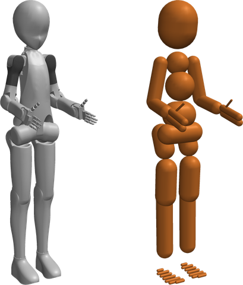
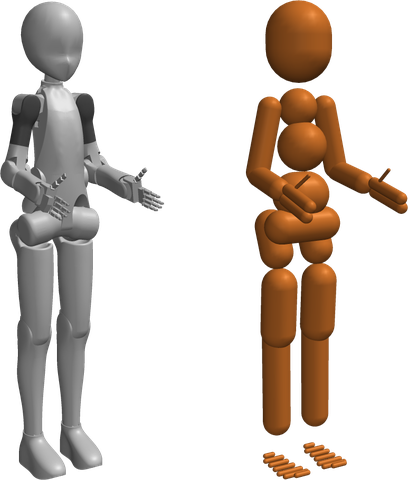
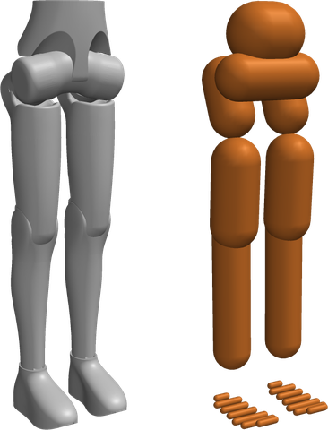
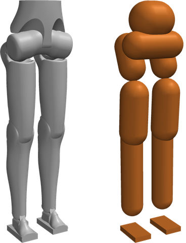
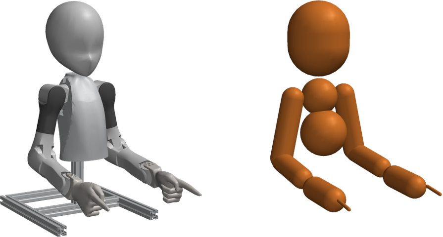
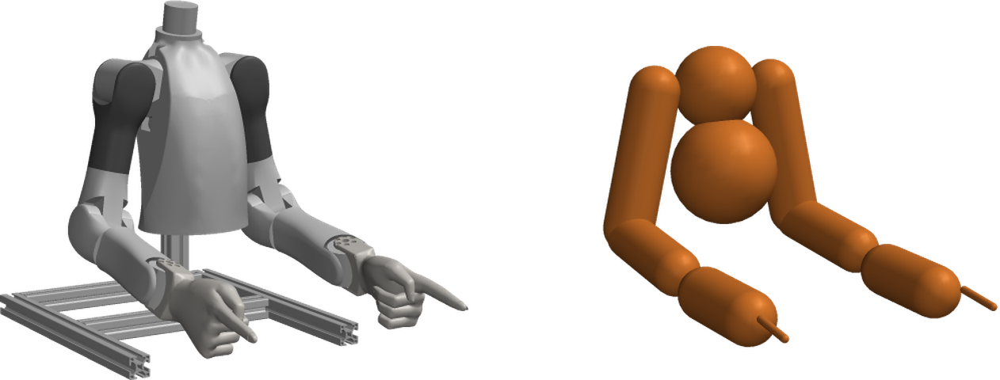

# Lite Description

[](https://www.python.org/)
[](https://docs.ros.org/en/jazzy/)
[](LICENSE)

This repository has the robot descriptions of the Berkeley Humanoid Lite V2, an open-source humanoid with [RobStride](https://robstride.com) actuators. Each variant has a URDF, an MJCF, a xacro and meshes. A generator makes these files from the Onshape CAD, so do not edit them by hand.

## Variants

Each image shows the visual meshes (left) and the colliders (right).

<table>
  <tr>
    <td align="center"><br><code>lite</code></td>
    <td align="center"><br><code>lite_pro</code></td>
    <td align="center"><br><code>lite_biped</code></td>
    <td align="center"><br><code>lite_biped_debug</code></td>
  </tr>
  <tr>
    <td align="center" colspan="2"><br><code>lite_dummy</code></td>
    <td align="center" colspan="2"><br><code>lite_bimanual</code></td>
  </tr>
</table>

| Variant | Body | DoF | Root | `ros2_control` |
|---|---|---|---|---|
| `lite` | Full body: legs, 1-DoF waist, arms, neck, 5-finger hands | 72 | `pelvis`, fixed | Model only |
| `lite_pro` | Full body: legs, 3-DoF waist, arms, neck, 5-finger hands | 74 | `pelvis`, fixed | Model only |
| `lite_biped` | V2 legs: 3-DoF hip, knee, 3-DoF ankle | 14 | `pelvis`, free | RobStride, 2 CAN buses, base IMU |
| `lite_biped_debug` | `lite_biped` with a flat debug foot | 14 | `pelvis`, free | RobStride, 2 CAN buses, base IMU |
| `lite_dummy` | V1 upper body: arms, neck | 17 | `chest`, fixed | RobStride, 2 CAN buses |
| `lite_bimanual` | V2 arms, no neck | 14 | `chest`, fixed | RobStride, 2 CAN buses |

In the MJCF, a "free" root body has a free joint, and a "fixed" root body is fixed to the world.

## Use

### Python: MuJoCo, mjlab and Isaac Lab

```bash
uv add git+https://github.com/berkeley-humanoids/lite_description.git
```

```python
import mujoco
from lite_description import get_mjcf_path, get_urdf_path

model = mujoco.MjModel.from_xml_path(str(get_mjcf_path("lite_biped")))  # MuJoCo, mjlab
urdf_path = get_urdf_path("lite")                                      # Isaac Lab
```

The package has no dependencies, so the example also needs `mujoco`. `VARIANTS` lists the variant names, and a name that is not in `VARIANTS` raises `ValueError`. Each URDF and MJCF finds its meshes by a relative path, so load each file where it is. The `uv.lock` of your project pins the commit, so the assets change only when you upgrade `lite-description`. `lite_description.actuators` has the actuator spec tables and the BeyondMimic formulas for the PD gains.

### View a model

This script shows a model in its zero pose. The script does not step the physics, because the model falls with the default actuator gains.

```python
import time

import mujoco
import mujoco.viewer
from lite_description import get_mjcf_path

model = mujoco.MjModel.from_xml_path(str(get_mjcf_path("lite")))
data = mujoco.MjData(model)
with mujoco.viewer.launch_passive(model, data) as viewer:
    while viewer.is_running():
        time.sleep(0.1)
```

To show the colliders, press 3. On macOS, run the script with `mjpython`.

### ROS 2

`lite_description` is also an `ament_cmake` package. Build it with `colcon build` in a ROS 2 workspace. Then expand the xacro of a variant:

```bash
xacro $(ros2 pkg prefix --share lite_description)/robots/lite_biped/xacro/lite_biped.urdf.xacro
```

The mesh paths use `package://lite_description/robots/<variant>/meshes/visual/`. For the hardware backends, see [ros2_control](docs/ros2_control.md).

## Conventions

- Frames: x forward, y left, z up ([REP 103](https://www.ros.org/reps/rep-0103.html)). Units are SI, and angles are in radians.
- Joint names: `[<side>_]<part>_<axis>`, for example `left_knee_pitch` and `waist_yaw`. Finger joints are `<side>_finger<n>_j<k>`.
- `base_link`: only the xacro adds it, for ROS and KDL.
- MJCF geom groups: the visual meshes are in group 1 and the colliders are in group 3. The MuJoCo viewer hides group 3 by default.
- MJCF actuators: each actuated joint has one `<position>` actuator, with the effort limit as its `forcerange`. The actuators keep the MuJoCo default gains, `kp` 1 and `kv` 0. Thus set `kp` and `kv` on the actuators before you simulate.
- Mass: each body has an explicit `<inertial>`. Thus a change to its geoms does not change its mass properties.

## Design notes

- The geometry is for simulation. Each link has one merged and simplified visual mesh, with one color and a size of about 2 MB or less. This repository has no detailed model for renders. For renders, use the Onshape CAD.
- Each variant has one collider set, mostly capsules. To use fewer colliders in a biped, select them by name at load time. See [Colliders](docs/colliders.md).
- The URDF colliders are cylinders, and the MJCF colliders are capsules. Thus a URDF consumer, for example Isaac Lab, gets shorter colliders with flat ends. See [Colliders](docs/colliders.md).

## Documentation

- [Colliders](docs/colliders.md): the collider design, collider selection and the optional sole hull.
- [ros2_control](docs/ros2_control.md): the hardware backends and the xacro args.
- [Generation](docs/generation.md): the generator, collider editing, the README images and the tests.

## License

[MIT](LICENSE)
